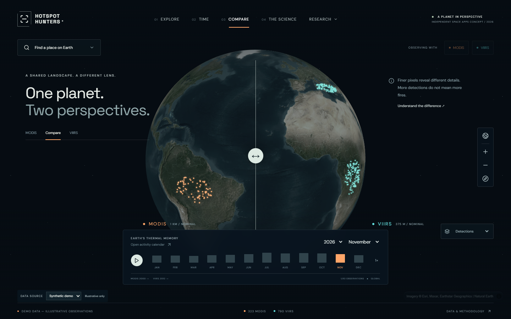

# Hotspot Hunters — جاهزية النسخة المحلية

**النتيجة: Conditionally Ready — جاهز للعرض المحلي بشروط واضحة، وليس اعتمادًا للنشر العام أو لإنتاج نتائج harmonized.** نُفذت المراحل 0–7 على نفس المشروع، دون تغيير الـstack أو رفع الكود أو تعديل أي ملف داخل `backend/`. لم يبقَ عيب Critical أو Major مؤكد في وظائف الفرونت ضمن الاختبارات المنفذة. الشروط المتبقية تتعلق بتاريخ Git المحتوي على `.env` سابقًا، وحدود الباك والأداء والتحقق على أجهزة ومتصفحات أخرى.

التاريخ: 14 نوفمبر 2026. الفرونت: `D:\Hotspot hunters2\Hotspot-hunters`. الفرع المحلي: `frontend/competition-phases-2026-11-13`. لا commit أو push أو نشر. الدليل التفصيلي للعقد الحقيقي في [تقرير API](phase-3a-api-contract.md)، ونتائج المراحل السابقة في نهاية هذا التقرير. Phase 5 المكررة في ملف المستخدم نُفذت مرة واحدة.

## ما يعمل بالفعل

بقيت Landing وExplore وGlobe/Mercator والبحث عن المناطق والـsensor filters والـTimeline والتقويم والمقارنة والتفاصيل وصفحة Science موجودة. أضيفت Analytics بخدمات aggregates ورسوم ذات جداول مقروءة، وData Explorer بفلاتر native وثقة منفصلة وفرز وتقسيم صفحات client-side وتفاصيل وfocus/highlight للخريطة وتصدير CSV/GeoJSON، وResearch Workspace للحفظ والتعديل والنسخ والحذف محليًا وروابط snapshot، وHarmonization Lab لسبع مراحل ذات حالة Implemented أو Conceptual أو Planned.

الفصل بين Synthetic demo وBackend / FIRMS صريح. فشل API أو نتيجته الفارغة لا يستبدلان ببيانات ديمو. FRP يبقى MW، والوقت UTC، والمصدر والـprocessing والـoriginal properties محفوظة. الأعداد سجلات satellite hotspots خام وليست حرائق مؤكدة؛ لا درجة ثقة مشتركة بين MODIS وVIIRS ولا نتيجة معايرة أو harmonization مزعومة.

التكامل يستخدم المسارات الموجودة فقط: `/api/v1/map/geojson` و`/api/v1/calendar` و`/api/v1/summary` و`/api/v1/quality` و`/api/v1/analyze` في raw mode ضمن النطاق القصير، و`/api/v1/download/csv`، و`/api/v1/sensors` و`/api/v1/methodology`. `/health` متاح في العميل، لكنه لا يُستخدم لتسمية بيانات ديمو بأنها live. لم تُخترع pagination أو authentication أو server research endpoints.

## الاختبارات النهائية

`npm run build` نجح مع TypeScript strict وVite، و`npm test` اجتاز **58/58**. الأمر الدائم `npm run test:browser` اجتاز اختبار الصفحات القديمة والموبايل والخريطة وملاحظة VIIRS والفلاتر والتقويم والمقارنة والـScience وفشل imagery الخارجي.

الاختبارات الإضافية على Chrome اجتازت API **10/10**، Analytics **11/11**، Data Explorer **16/16**، Research/Lab **17/17**، الخريطة **14/14**، وحالات حواف الخريطة **4/4**. اختبارات إصلاحات التدقيق الموجهة اجتازت **10/10**، وتشمل تاريخ CSV المخصص، zero مقابل unavailable، one-shot share import، استعادة focus، ربط أخطاء الحقول، وإزالة تداخل Timeline/source controls. الاختبارات تشمل fixtures مأخوذة من العقد الموثق وطلبات إلى الباك المحلي الفعلي؛ لا تُفسر كاعتماد مستقل لصحة الداتا الأصلية.

نسخة production على `4173` اختُبرت في 9 مشاهد عند `768×844` و`390×844` و`320×568` و`844×390`، إضافة إلى desktop `1440×900`. اجتازت احتواء الوثيقة أفقيًا وظهور أزرار التنقل ضمن العرض وإتاحة scroll للمحتوى الطويل. جرى فحص التباين والـlabels والـARIA باستخدام axe بقواعد WCAG 2 A/AA و2.1 A/AA: **صفر violations في 14 سيناريو**، تشمل الـ9 مشاهد وقائمة Research المفتوحة و4 صفحات جديدة في real mode. هذا فحص آلي، لا شهادة توافق WCAG ولا بديلًا عن جلسة NVDA/JAWS بشرية.

لم تظهر page errors أو console errors في اختبارات production. اختبارات المعمارية الأخيرة لم تجد circular imports أو HTML sinks غير آمنة أو UTF-8 replacement characters. الـMapLibre debug object غير متاح في production. فحص dependencies بـ`npm audit --json` أرجع **0 vulnerabilities معلنة** وقت التنفيذ؛ لا يعني ذلك غياب كل مخاطر dependencies.

اختبارات الباك الأصلية عند إعدادات الجهاز الحقيقية تعطي 37 نجاحًا و1 فشلًا، وهو نفس فشل خط الأساس: اختبار `map_key=None` يأخذ المفتاح من settings بدل محاكاة عدم وجوده. عند عزل `settings.FIRMS_MAP_KEY=None` داخل **عملية test فقط** اجتازت **38/38** مع warning deprecation واحد. لم يُغيّر ملف الباك أو المفتاح المحفوظ أو عملية السيرفر القائمة.

## عيوب التدقيق وإغلاقها

المراجعة المستقلة موزعة على الوظائف والأداء والسلامة العلمية والتجاوب والإتاحة وعقد API والأمان. تقاريرها [في التقرير المستقل](phase-7-independent-review.md) تعكس الحالة **قبل** إصلاحات الإغلاق التالية، وليست النتيجة النهائية.

أُصلح Worker الخاص بـMapLibre، وتنظيف الخرائط والـlisteners، وجاهزية المصادر، وتفاعل نقاط/cluster على جانبي المقارنة، وتزامن الكاميرا والإسقاط، والـhover وhighlight، وحالات imagery/WebGL failure. التبديل بين الطبقات وحده لا يعيد `setData` الكامل عند ثبات records.

أُصلح رابط Backend CSV ليستخدم `activeDates` بدل الشهر التقويمي، مع تنبيه أن فلاتر Explorer الإضافية لا يطبقها هذا الرابط. وُسمت أعداد footer بـLOADED SUBSET عند partial. الملخص السنوي الناجح بقيمة 0 يبقى reported zero؛ missing محجوز لفشل الطلب. regional summary غير المتاح يُعرض Unavailable لا صفرًا، ولا توضع نقطة صفر مصطنعة في الرسم عند فشل السنة.

روابط Research تُستورد مرة واحدة ثم يُزال hash من العنوان دون إرسال شيء خارجي. تم اختبار تعديل snapshot وحفظه والعودة وإعادة فتحه دون الكتابة فوقه. أضيف SPA heading focus مع انتظار lazy components، واستعادة زر البحث عند Escape، ومؤشرات focus للخريطة ومدخل البحث، وربط أخطاء Research/Analytics/Explorer بالحقول. أُصلحت أسماء أزرار الأشهر/السرعة لتضم النص المرئي، وأزيل `aria-sort` غير الصحيح من زر الفرز مع إبقائه على `th`.

تداخل شريط DATA SOURCE مع Timeline أُزيل في desktop/tablet/mobile، وأعيد تحديد منطقة scroll لـScience/Calendar حتى تظل disclosures قابلة للنقر دون إخفائها خلف Timeline. لم تُحل المشكلة بـforce-click أو بتجاهل assertion.

أضيف calendar GET dedupe/cache محدود بـ24 نتيجة و30 ثانية، بمفتاح sensors مرتب، وإلغاء مستقل لكل مستهلك، وتنظيف failures وعدم cache قبل validation. طلب summary يسبق quality لأن المسارين الفعليين ينفذان نفس تحليل الباك cache-keyed؛ ذلك يمنع بدء التحليل نفسه مرتين بالتوازي. مصدرا الخريطة يتلقيان `id/sensor` فقط بدل metadata الخام كاملة، بينما التفاصيل والتصدير يحفظان السجل الأصلي. البحث المؤجل لم يعد يتبع search الحي في dependencies المكلفة، والتصدير GeoJSON لا يستخدم pretty-print غير الضروري. حُفظ حد التصدير 10MB وعدم truncation وCSV formula neutralization وobject URL revoke.

تم تشديد confidence native integer/category وHTTP fallback byte checking، مع اختبارات جديدة. حُذف `.env` من **فهرس Git فقط** وأضيفت قواعد تجاهل؛ الملف المحلي ما زال موجودًا. فحص artifact قارن قيم البيئة في الذاكرة فقط، ولم يجد قيمة private من البيئة داخل `dist`. لم تُطبع القيم أثناء فحص artifact ولم تُضمّن في الملفات المسلّمة.

## قياسات الأداء الفعلية

البيئة: Windows المحلي، Chrome headless `157.0.8103.52`، production preview على `4173`، desktop `1440×900`، reduced motion، بلا CPU/network throttling. الأرقام snapshot واحدة لقياس محلي وليست p95 أو benchmark لجهاز هاتف. طلبات الباك يمكن أن تستفيد من cache. map initialization تعني تهيئة style/sources المحلية، **لا اكتمال تحميل كل imagery خارجي**.

في تشغيل production الأخير، بدء الصفحة حتى controls/map-ready استغرق **1,078ms**؛ navigation load event **438ms**؛ First Contentful Paint **844ms**؛ وتهيئة الخريطة **223ms**. عرض **5,000 سجل حقيقي محمل** استغرق **1,637ms**؛ رُسمت 25 row للصفحة الافتراضية، مع سقف 100 row. البحث عن ID واحد أخذ **65ms**، وتصدير CSV للسجل المفلتر أخذ **168ms** وحجمه 774 bytes. هذه أرقام عملية browser automation، لا زمن CPU خالص ولا أداء تصدير 5,000 سجل كامل.

جاهزية Analytics في real mode استغرقت **5,444ms** وتشمل التقويم والسنوات والمناطق والـquality/spatial queries. في تجربة سابقة فشل cold monthly aggregation عند timeout 15 ثانية؛ عُرض error/retry صحيح بلا ديمو، ثم عُدّل تسلسل summary/quality اعتمادًا على cache الباك الموثق ونجحت إعادة الاختبار. لا يزال timeout ممكنًا مع الباك البطيء أو النطاقات الثقيلة؛ اختيار فترة أقصر أو Retry مسار معلن، وليس إثبات أن كل نطاق عالمي سيكتمل تحت 15 ثانية.

بعد 10 دورات Compare↔Explore مع GC قبل/بعد: heap من **46,844,684 إلى 47,512,156 bytes**، وزيادة تقريبية **0.67MB**؛ بقي canvas رئيسي واحد، وزمن الدورات **4,609ms**. هذه نتيجة قصيرة لا تثبت غياب تسرب على المدى الطويل. سجل PerformanceObserver أظهر 31 long tasks في **رحلة QA بأكملها**، أطولها 478ms؛ الرحلة تشمل تشغيل axe وserialization والتنقل، لذلك لا تُنسب كلها للتطبيق أو للـinitial load.

آخر Vite build استغرق نحو **6.17 ثانية**. الـinitial JS `1,349.63kB`، gzip الذي أعلنه Vite `383.32kB`؛ CSS المشترك `101.94kB`، gzip `17.42kB`؛ MapLibre module worker `520.11kB` مستقل. الـlazy JS: Analytics `32.13kB`، Data Explorer `20.82kB`، Research `23.27kB`، Lab `21.12kB`. التحذير أن main chunk أكبر من 500kB ما زال موجودًا بسبب المكتبات الأساسية؛ لم يُخفَ. أحجام gzip في JSON قد تختلف قليلًا عن Vite بسبب compressor، ولا تعني payload غير مضغوط ومضغوط معًا.

## القيود المتبقية وشروط الاستخدام

**قبل مشاركة Git أو نشره:** `.env` كان محفوظًا في history الأصلية. إيقاف تتبعه الآن لا يمحو التاريخ. يجب تدوير الاعتمادات التي كانت داخله ومعالجة تاريخ المستودع وفق سياسة صاحبه قبل نشره. لم أدوّر المفتاح أو أعد كتابة history، ولم يتم أي رفع. كذلك request logging الخاص بـhttpx في اختبارات الباك قد يتضمن URL به اعتماد؛ لا تُشارك سجلات الباك الخام قبل sanitization. هذه مشكلة باك/مستودع أصلية خارج حدود تعديل الفرونت، ولا تظهر القيمة داخل artifact الأمامي المفحوص.

الباك لا يدعم pagination حقيقية للملاحظات؛ map/Explorer يعرضان loaded subset بحد 5,000، وتقسيم الصفحات محلي فقط. aggregates وBackend CSV قد تقف عند 50,000؛ لا يُعامل عدد أقل من الحد كدليل اكتمال التغطية. export المحلي يشمل كل **filtered loaded records** لا الصفحة الحالية ولا كل نتائج السيرفر غير المحملة. source update time وper-sensor FRP sum وday/night distribution ليست متاحة من aggregate contract في كل الحالات وتظهر Unavailable بدل اختراعها.

Research محفوظ في localStorage على نفس origin/browser، وليس حسابًا أو تخزينًا خادميًا أو backup. `5173` و`4173` أصلان مختلفان، فلا تتوقع ظهور نفس Research library تلقائيًا بينهما؛ snapshot URL ينقل وصفة selection للمراجعة فقط وقد يتضمن notes. لا تضع أسرارًا في ملاحظات مشاركة الرابط.

Lab تعليمي ومنهجي حيث لم يوثق الباك calibration/independent validation قابلًا للاستخدام؛ لا يخرج harmonized index. request validation/error details في بعض routes الخاصة بالباك تحتاج تحسينًا قبل public API؛ الفرونت يتحقق محليًا ويعرض رسائل آمنة بدل body الخام، ولم يُعدل الباك. static guards ليست شهادة لصحة كل حقل scientific في upstream data.

التحقق الآلي شمل Chrome على هذا الجهاز والمقاسات المذكورة، لا Safari/Firefox أو أجهزة GPU أخرى أو NVDA/JAWS بشرية. imagery/fonts الخارجية تحتاج الإنترنت؛ فشل imagery له warning ولا يُعتبر غيابًا للبيانات المحلية. الوضع القصير يستخدم صفحة بارتفاع أدنى 700px مع scroll للوثيقة وscroll داخل panel؛ لا يوجد ادعاء أن كل المحتوى يظهر دون تمرير على 568px.

## الوصول والأدلة

التطبيق الحالي: [نسخة التطوير](http://127.0.0.1:5173) و[نسخة production المحلية](http://127.0.0.1:4173). هذه عناوين نفس الجهاز، لا روابط عامة. خطوات التشغيل وإعادة الاختبار في [دليل التشغيل](../local-run-guide.md).

الأدلة التفصيلية محفوظة داخل `.work/phases/release` و`.work/phases/phase2` و`phase3b` و`phase4` و`phase5` و`phase6`؛ `final-proof.json` للقياسات و`browser-result.json` للفحوص الآلية و`fix-result.json` لإغلاق العيوب و`security-integrity.json` لفحص artifact و`npm-audit.json`. الصور والfixtures وscripts العمل باقية للمتابعة، ولا تحتوي حزمة التسليم على `.env` أو raw backend logs.

لقطة المقارنة التالية من فحص production في **demo mode**؛ هي توثيق للواجهة لا بيانات قياس علمي:

تقارير المراحل: [0 — الخط الأساسي](phase-0-baseline.md)، [1 — المعمارية](phase-1-architecture.md)، [2 — الخريطة](phase-2-map.md)، [3A — العقد](phase-3a-api-contract.md)، [3B — الدمج](phase-3b-integration.md)، [4 — Analytics](phase-4-analytics.md)، [5 — Explorer](phase-5-explorer.md)، [6 — Research](phase-6-research.md)، [6 — Lab](phase-6-lab.md). التقارير تاريخية؛ هذا التقرير هو حالة الإغلاق الأحدث بعد fixes التدقيق وإعادة الاختبارات.

آخر إعادة تحقق بعد استعادة `aria-sort` على رأس العمود وحده: build ناجح، 58/58 unit، Explorer16/16، QA-fix10/10، وproduction14/14 سيناريو axe بلا violations؛ جميعها على الكود النهائي لا قبل الإصلاح.
